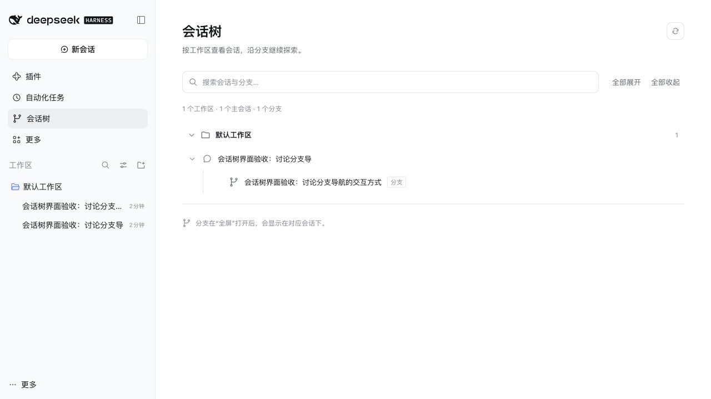
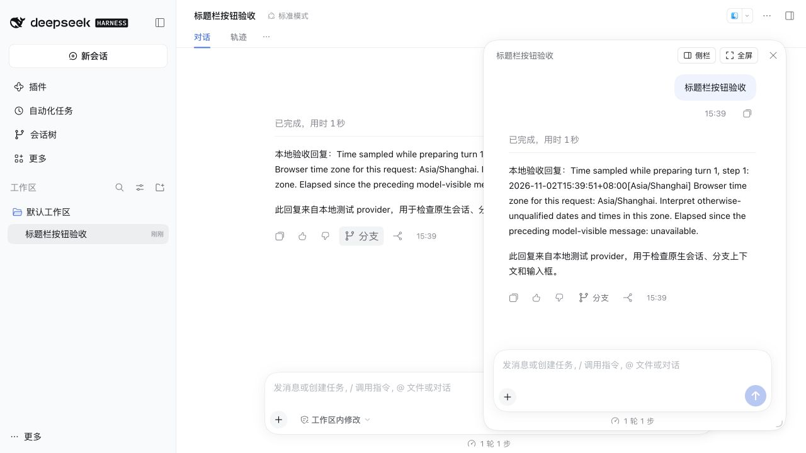
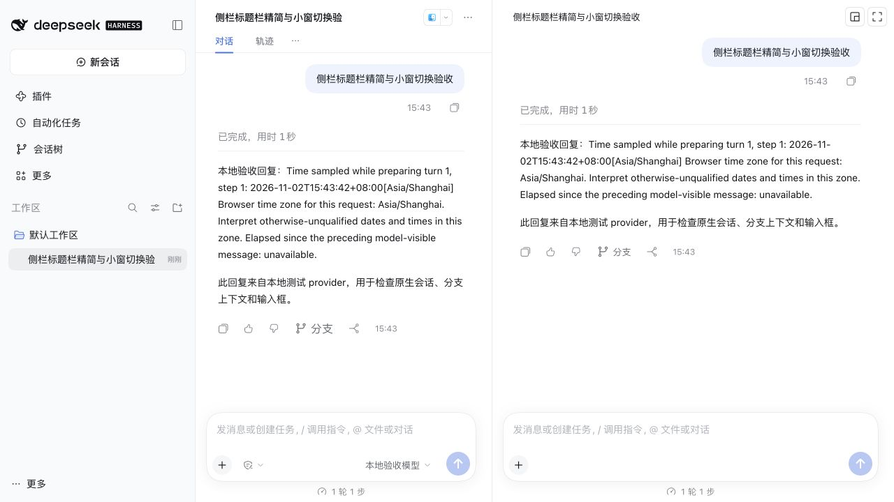

# DSH Conversation Tree

DeepSeek Harness 的原生可编辑会话分支插件。在回答或选段处继续追问，通过浮窗、侧栏和会话树管理探索过程。

这是独立的社区插件，与 DeepSeek 官方没有隶属关系。当前版本 **1.0.7**；已在 **DSH 0.2.1-rc.5、macOS ARM64 的隔离 Web profile** 验收。Electron 桌面版的逐项验收尚未完成，其他宿主版本及平台需要复测。

## 功能

- 从已完成的回答创建真实 Session 分支，保留对应轮次的上下文，可连续追问。
- 划词后“从这里追问”，选段填入原生输入框；重新划词替换当前分支草稿。
- 在可缩放浮窗、右侧栏与主页面之间切换，使用 DSH 原生聊天和输入框。
- “钉回主线”将分支回答摘录填入父会话草稿，**由用户检查后手动发送**。
- 会话树按工作区、会话标题和分支展示，支持搜索、折叠和打开。







截图均来自隔离环境中的测试会话，不代表在线 DeepSeek 模型输出。

## 安装

1. 在本仓库 [Releases](https://github.com/Bevily/dsh-conversation-tree/releases) 页面下载 `dsh-conversation-tree-1.0.7.tgz`。请选择 Release 附件；GitHub 自动生成的 Source code 压缩包是源码，不是插件安装包。
2. 打开 DeepSeek Harness，进入左侧「插件」。
3. 点击「添加插件」（或箭头菜单中的「安装第三方插件」）。
4. 在「包名或地址」中粘贴下载文件的本地绝对路径，**不要加引号**。例如 macOS 路径格式：`/Users/你的用户名/Downloads/dsh-conversation-tree-1.0.7.tgz`。
5. 点击「安装」，按提示启用插件或重启应用。

首次公开 Release 尚需发布；也可按下方开发步骤自行构建安装包。

桌面版的 `desktop` profile 由 Electron 应用独占管理，不能使用 `dsh plugin --profile desktop add` 安装。CLI 仅用于非 Electron 管理的 profile，例如隔离测试使用的 `web` profile：

```sh
dsh plugin --profile web add /absolute/path/dsh-conversation-tree-1.0.7.tgz
```

### 升级

操作前备份 `$DSH_HOME/plugins/conversation-tree/state.json` 以及原生 Session 数据。同名第三方插件可能需要先卸载旧版再安装；不要同时加载两个会话树实现。更新后确认 Host 的 `conversation-tree` 和 Client 插件均激活。

插件不主动迁移原生 Session；关系元数据保持 version 1 格式，遇到损坏或不支持的状态文件会报错，不会静默覆盖。

## 使用

1. 将父会话放在工作区中。在已完成回答的操作行点击“分支”，或在同一轮消息内划词并点击“从这里追问”。
2. 浮窗打开后可继续输入问题，拖动标题栏移动，拖动右下角标记调整宽高。
3. 点击“侧栏”停靠到右侧；侧栏标题旁的两个图标分别为“退回小窗”和“全屏”，悬停可查看提示。侧栏中的“全屏”展开当前分支面板，保留输入框草稿，再次点击“还原侧栏”返回分栏；浮窗中的“全屏”在主页面打开分支。两种操作都会将分支提升为正式会话。
4. 分支最后一条独立完成的回答可“钉回主线”。摘录进入父会话原生草稿，保留原有草稿，由用户手动发送。
5. 在“会话树”搜索、展开或打开正式会话与已提升分支。未全屏提升的分支不展示。

同一父会话、同一轮、同一类型复用分支；回答分支与选段分支相互独立。引用格式为 `> 原文` 加一个换行，无额外空行。重新划词会替换整个当前分支草稿，请在选好引用后再输入问题。

## 数据与已知限制

会话内容保存在 DSH 原生 Session log；关系文件 `$DSH_HOME/plugins/conversation-tree/state.json` 保存父子关系、轮次、分支标签、可见性和时间。创建分支会通过 `agents.create` 复制截至选定轮次的上下文，恢复使用 `agents.resume`。

- 父轮次必须完成；跨多个轮次的选区不提供追问入口。
- 未提升分支通过 CSS 从普通会话列表隐藏，这是界面过滤；刷新启动时可能短暂出现一行，不提供 Host 级隔离。
- “钉回主线”为可编辑摘录，最多 2000 字，超出时明确标注截断；没有额外调用模型生成语义摘要。
- 标题栏、缩放触点与侧栏精简依赖 dockkit DOM 标记；DSH 升级后需要复测。
- 插件不写 `scrollTop`，不观察消息来强制滚动。
- 在线模型成功回复尚未完成验收；原生 agent loop、多轮与流式成功验证使用本地测试 provider。

完整证据和验证边界见 [验收记录](docs/validation.md)。声明的 DSH 引擎范围为 `>=0.2.1-rc.5 <0.3.0`，不等于已实测该范围内所有版本。

## 开发

需要 Node.js 22 或更新版本。

```sh
npm ci
npm run pack
```

该命令完成构建、语法检查和测试，并生成：

- `dist/dsh-conversation-tree-1.0.7.tgz`
- `dist/SHA256SUMS`

`src/host` 管理分支与持久化，`src/client` 管理原生 slot 接线与树页面。`client.js` 是需要随源码提交的构建产物；React 由 DSH 宿主提供。

更多说明见 [参与开发](CONTRIBUTING.md)、[更新记录](CHANGELOG.md) 和 [发布指南](docs/releasing.md)。反馈问题请在 Issues 中注明插件版本、DSH 版本、操作系统和复现步骤，截图与日志请先脱敏。

## 许可证

本插件采用 [MIT License](LICENSE)。DeepSeek Harness 的名称、商标及宿主软件遵循其各自的权利和许可。
