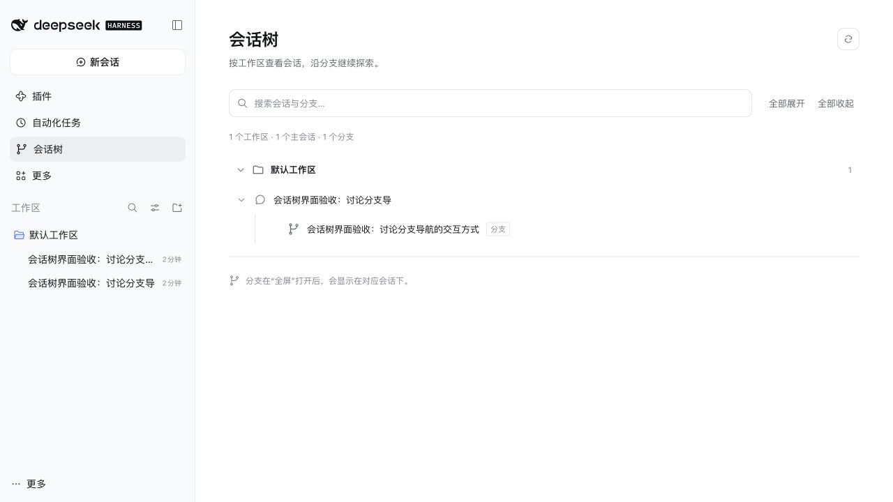
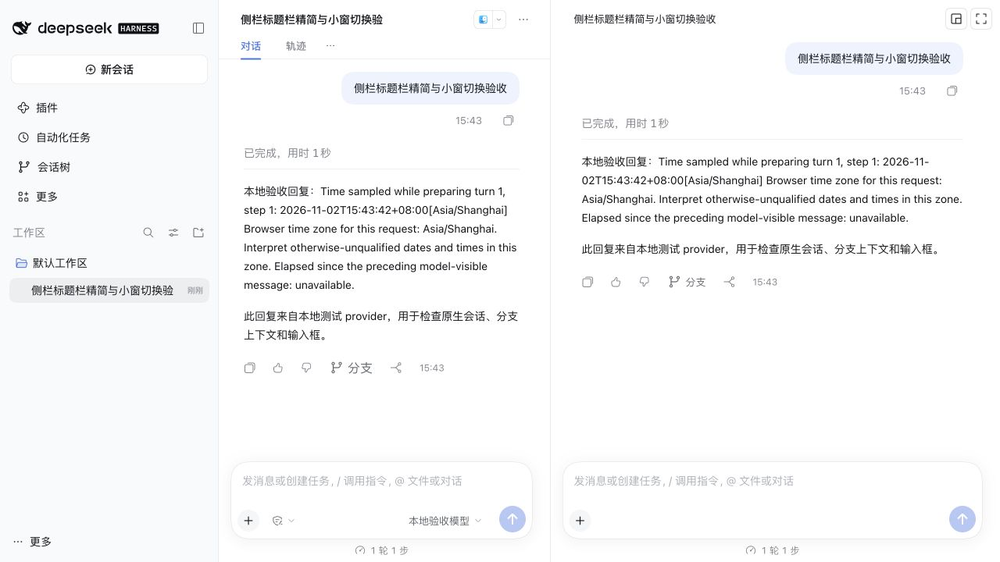
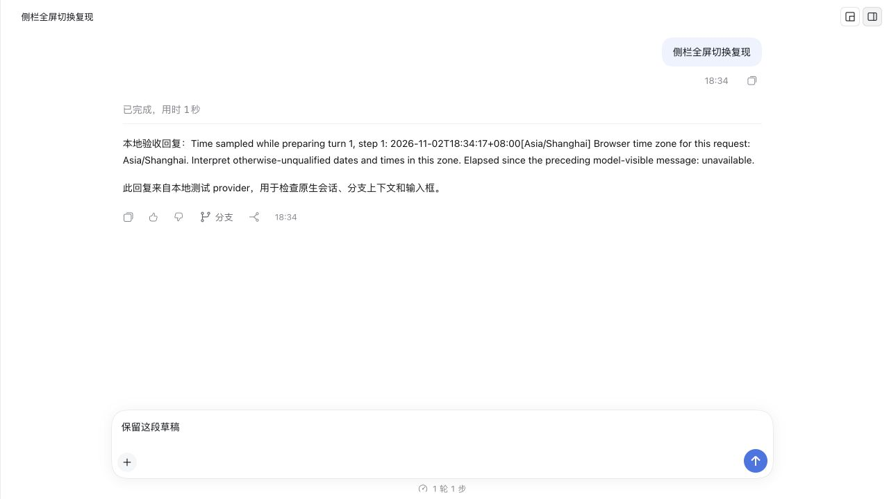
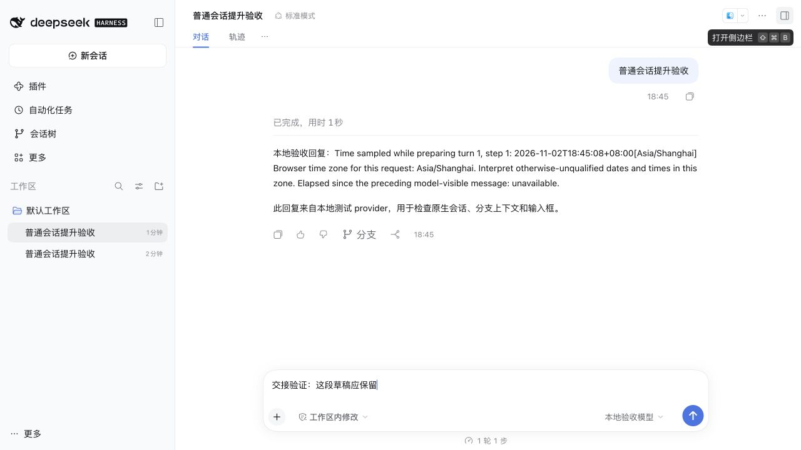
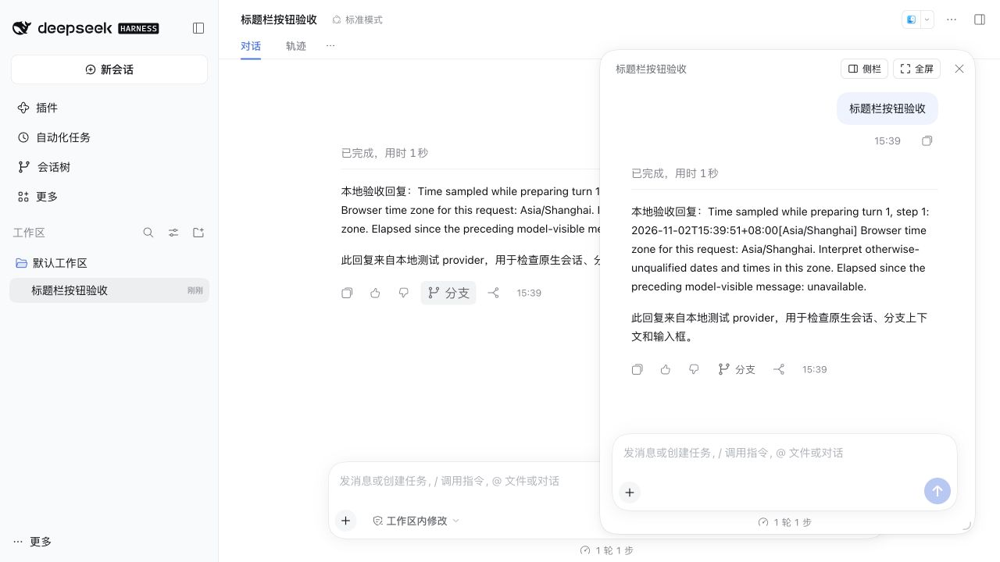

# 验收记录

日期：2026-11-02（Asia/Shanghai）。本机 DSH Desktop 随附运行时 **0.2.1-rc.5**，macOS ARM64。测试使用独立 `DSH_HOME`、Web profile 与 DSH 原生前端，未修改现有 desktop profile 或旧插件。

## 已验证

- `npm test`：11 项全部通过（含 1.0.3 新增的树模型用例）。覆盖非连续 seq 的准确 seed 前缀、未完成轮次拒绝、并发创建去重、按 turn/kind 隔离、元数据持久化、重启复用、promote、pin 不复制继承回答且不发送、损坏状态不覆盖、失败事务后恢复、attach 失败幂等重试。
- `npm run build`、`npm run check` 通过；tgz 文件白名单检查覆盖运行文件、README、更新记录、已筛选文档图片及MIT 许可证；不含凭据、测试 Session、node_modules 或 DSH 源码。
- 使用随附 CLI 的 `plugin --profile web add <tgz>` 安装成功，profile 自动加入 bundle；去掉源码 patch 后从 tgz 启动，入口和分支均正常激活。
- 已完成 assistant 回答操作行出现“分支”；真实 `agents.create` 产生 Session，seed 截止对应 turn/end；原生浮窗显示继承历史及可写 composer。
- 本地 provider 通过真实 DSH agent loop 发送、逐块流式回复、连续追问；重启 Host 后同一 Session 可继续发送。
- 实际划词第一轮与第二轮分别创建 selection 分支；右侧栏已展开时替换分支 tab；选段原文进入 retained binding 对应的原生 composer。
- “钉回主线”进入父会话草稿，主线仍保持原轮次数，未触发发送。
- 原生 floating tab、侧栏 dock、全屏提升均实测。浮窗标题同一行包含可点击的“侧栏”“全屏”；DOM 检查确认按钮不在 title chip 内，原生 dock 按钮为 `display:none`。
- 浮窗/侧栏分支不出现在原生会话行或“未分组”；promote 后出现正式行。会话树搜索显示工作区 → 父标题 → 已提升分支，隐藏分支不出现。
- 嵌入 composer 的模型和权限 slot 均为 `display:none`；原生输入框、发送和附件保留。
- 本地 TEST_ERROR 显示原生错误块。手动上滚后原生“回到底部”按钮出现，插件没有自动拉回；源码没有任何 scrollTop 写入或自动滚动 observer。

## 1.0.3 会话树 UI 验收

- 使用 DSH 原生语义颜色、字体、圆角，页面填满 main slot，内部内容最大宽度 1120px；替换浏览器默认 details 样式。
- 工作区分组、会话/分支图标、层级线、长标题截断、搜索清除、全部展开/收起，以及加载、失败重试和无结果状态。
- 隔离 Web profile 从 tgz 安装后，使用本地 provider 创建真实会话和分支并提升。实测全部展开/收起、搜索保留父链、无结果提示、清除搜索、点击分支回到原生会话；最终小幅调整默认工作区中文显示和搜索时折叠控件禁用后，使用同一构建产物刷新复查。
- 窄窗口（700px）检查时 main slot 的 clientWidth 与 scrollWidth 均为 644px，无横向溢出。检查后恢复默认窗口尺寸。最终浏览器错误/警告日志为空。
- 新增树模型测试覆盖隐藏祖先过滤、被提升后代可达、搜索父链、无结果与空白关键词；与原有 9 项 Host 测试一起通过。
- 本次验证为本机 DSH Web UI；未实际切换深色主题或在 Electron 主窗口复测。



## 1.0.4 浮窗缩放修复

- 复现：原生 `[data-dockkit-float-resize]` 的右下角命中测试返回输入框 card，缩放触点被 composer 覆盖。
- 仅对分支浮窗添加作用域 class，提高原生触点层级，将触点增至 24px 并持续显示角标；不重写拖动事件或原生尺寸状态。
- 在 DSH Web 隔离环境实际拖拽：480×620 → 360×500 → 440×560；刷新后仍为 440×560。构建、语法检查与 11 项测试通过。Electron 主窗口尚未复测。

缩放后的尺寸通过原生布局记录和页面几何测量确认。

## 1.0.5 标题栏动作样式

- “侧栏”“全屏”改为有边框、背景及图标的紧凑按钮，沿用原生语义颜色和现有动作。
- 构建、语法检查通过；在隔离 DSH Web 页面检查按钮显示。

## 1.0.6 侧栏标题栏精简

- 分支处于侧栏模式时，将动作移到标签外侧；仅保留对话标题、退回小窗、全屏两个图标按钮。隐藏该状态下重复的原生 tab/布局控件，其他标签仍保留在原生布局中。
- 实际隔离 DSH Web 页面检查仅有一个标题和两个按钮；实测浮窗 → 侧栏 → 小窗 → 侧栏 → 全屏提升成功。
- 构建、语法检查与 11 项测试通过。该标题栏兼容层依赖 DSH dockkit DOM 标记，升级 DSH 后需复测。



## 1.0.7 侧栏全屏切换（此语义已在 1.0.8 更正）

- 旧行为将分支打开为主会话后关闭侧栏 tab；侧栏全屏现在改用 `sidebarRight.toggleFullscreen`，不关闭 tab、不导航离开父会话。
- 在同一隔离 DSH Web 会话验证：侧栏全屏后仍为相同 branch Session，宽度从约 575px 展开至 1279px，输入框“保留这段草稿”仍在；还原后宽度返回约 575px，再次全屏及退回小窗均成功。
- 继续保留 promote 可见性语义，分支出现在正式列表中；数据格式不变。
- 本次未在 Electron 主窗口验收。



## 1.0.8 提升为普通会话

- “全屏”恢复为普通会话提升；不调用原生面板全屏 API。分支 retained source 从 mainView 改为 sidebarView，避免嵌入分支持有主视图身份。
- `openSession` 返回 void，不能用 await 判定切换完成；现在保留 sidebarView 引用并同步卸载旧 tab 的嵌入输入框，再打开主聊天区并订阅原生 current binding 确认目标 Session。超时或调用失败时重新打开分支。
- 新增两项导航回归测试，覆盖异步切换确认与失败/超时恢复标签，共 13 项测试通过。
- 实际 DSH Web 验收：侧栏提升后主列表选中目标 branch Session，显示原生对话/轨迹标签、模型及权限控件；草稿“交接验证：这段草稿应保留”可见。浮窗提升同样成功，草稿保留。



## 在线模型验收限制

在线模型测试因账户额度耗尽返回 `ACCOUNT_QUOTA`。原生错误态正常，但在线成功回复、成功流式和完整多轮流程未通过。本地测试 provider 的结果不代表在线 DeepSeek 成功。

当前测试使用实际 DSH 的 Web profile 与 dockkit，尚未在 Electron 主窗口中逐项验收；平台相关标题栏和窗口行为需补测。

## 兼容性和明确实现选择

- 隐藏普通 Session 暂无已核实的原生接口。使用 attach 父工作区 + CSS 隐藏 Session 行；这是视图过滤，刷新启动到 catalog 读取完成之间可能短暂出现一行，不提供 Host 级不可见保证。
- 浮窗动作通过 portal 接到 dockkit header。这是集中封装的兼容层，DSH 升级后必须验证标记是否变化。
- 重启恢复使用 `dsh-resource://conversation-tree/session/<id>` 持久化身份。DSH tab 的 navigation params 是临时数据，不能用于重启恢复身份。
- “钉回主线”为可编辑摘录，超过 2000 字会标明截断；没有调用第二个模型自动生成语义摘要。
- 跨轮次的一次长选区暂不提供入口。同一轮内可选用户或 assistant 文本；父轮次必须已完成。
- 1.0.2 调整：选段复用时通过原生 draft initialization 的 replace 模式替换当前分支草稿；新引用仅为 `> 原文` 加一个换行，不追加旧引用。该调整已完成构建和语法检查，尚未重新进行桌面 UI 验收。
- 主动关闭/打开页面和 HMR 时曾观察到 DSH 自身 `gateway/cancelled`、inactive remote 警告；修复后的最终交互没有新增 conversation-tree slot 崩溃。未宣称全部 DSH 控制台日志绝对为空。

## 截图

公开文档仅使用已筛选的隔离测试会话截图。



## 复现

```sh
npm ci
npm run pack
./scripts/validate-local.sh
```

脚本创建临时 DSH_HOME、安装 tgz、注册 test-only provider，不加载用户凭据。打开输出的 localhost token URL，按 README 操作；发送“测试错误”可检查原生错误块。脚本退出时清理其临时 profile。临时 profile 在验证结束后清理；公开截图保留于 docs/images。
